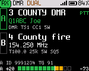
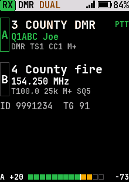
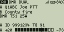
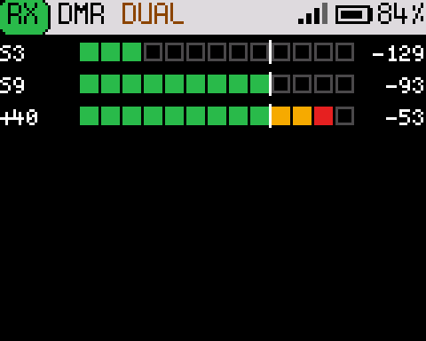
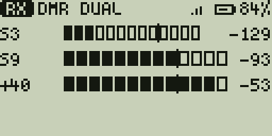
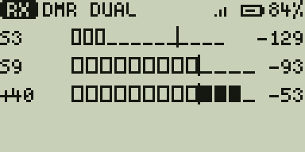

<!-- SPDX-License-Identifier: MIT -->
<!-- Copyright (c) 2026 The RadioFoundry Authors -->
<!-- Copyright (c) 2026 David Behnke -->

# Power, caller identity, and receive signal: review proposal

**Research and host mockups only. No firmware behavior changes.** Based on fork commit
`bc5782c13aa9240b51aff5d6fc86a226d471bf4c`, November 24, 2026. These compositions evaluate pixel fit and information
priority before implementation. They do not change the recently restored production display.

## Recommendation

- Add the actual resolved transmit power label to each normal dual pane's detail row where it fits. Use the same
  board API as single display. A power label is not always a letter.
- Analog details: tone, bandwidth, power, squelch, such as `T67.0 25k H SQ1`. Digital details: protocol, timeslot
  when applicable, color code when space permits, power; for example `DMR TS1 CC1 H` or `P25 L`.
- Keep the channel name, receive frequency, selected PTT pane, caller identity, and numeric ID ahead of extra
  metadata. Do not shrink normal text or remove frequencies to force a third row onto the shortest screen.
- During FM or digital reception, use one full-width bottom row for the receive meter. Prefix it with the
  receiving pane, show 13 segments, then numeric dBm. Keep callers inside their panes. Restore the ordinary bottom
  controls when reception ends. Never rotate caller text and the meter on a timer.
- On color panels, the nine S segments are green, the next two yellow, and the last two red. The colors mean
  signal range, not danger, audio clipping, BER, or successful decoding. Keep the S9 divider and number so color
  is not required to interpret the meter.
- Use callsign and first name as the preferred compact identity **when structured data provides them**. Show
  additional names or location only after that identity fits. Preserve arbitrary contact labels and aliases as
  opaque text, using the existing fit/ellipsis rules. A space in a contact name does not prove a callsign/name
  boundary. Keep unknown numeric IDs and the existing contact lookup and privacy preferences.

## Preview index

The images show only the visible safe area. Native PNGs are one framebuffer pixel per image pixel. Comparison
sheets use exact 2× scaling. Each adjacent pair is baseline then proposed; the baseline runs the real unchanged UI.
The proposed side uses a separate host composition with real fonts and framebuffer drawing, not production layout
code. The real status strip and battery are retained. Radio/codec state, power, and RSSI on the proposed side are
fixtures, not measurements. Baseline simulator power labels are generic; proposed labels use the indicated board's
actual label set. Proposed signal values deliberately exercise S9 and the over-S9 colors.

| Board definition | Visible pixels | Comparison sheet | Focused example |
|---|---:|---|---|
| [boards/dm1701/board.mk](../../../boards/dm1701/board.mk) | 150×120, 5 px left/right hidden | [All cases](screens/dm1701/comparison.png) | [Dual caller + meter](screens/dm1701/dual-caller-proposed.png) |
| [boards/mduv380/board.mk](../../../boards/mduv380/board.mk) | 160×128 | [All cases](screens/mduv380/comparison.png) | [Dual FM receive](screens/mduv380/dual-fm-rx-proposed.png) |
| [boards/md9600/board.mk](../../../boards/md9600/board.mk) | 128×64 monochrome | [All cases](screens/md9600/comparison.png) | [Compact idle fallback](screens/md9600/dual-fm-proposed.png) |
| [boards/dm32/board.mk](../../../boards/dm32/board.mk) | 220×310, 10 px sides and 5 px top/bottom hidden | [All cases](screens/dm32/comparison.png) | [Dual caller + meter](screens/dm32/dual-caller-proposed.png) |





Each sheet includes idle dual analog/digital/P25; dual caller; single digital; long database name; unknown P25 ID;
single FM; unchanged large text; dual FM receive; dual P25 receive; and simulated simultaneous receive.

## What fits, and what needs a fallback

At 150×120 and 160×128, the normal dual pane can carry three rows without reducing the existing medium/small/tiny
font sizes. The third row carries the power label with protocol or analog metadata. A DMR receive frequency can
share the target row while idle, with the target shortened before the frequency. During receive the caller replaces
that target, as today. Extra caller/target details use available activity space. The RX meter occupies the bottom
hint row; it does not steal columns from the caller.

At 220×310, there is room for separate identity and ID/target lines. The prototype leaves spare vertical room rather
than filling it with optional names. Production should retain the existing pane expansion, zone/history content,
and single-call hierarchy, inserting these fields rather than adopting the prototype's simplified composition.

**At 128×64, a third metadata row on both panes does not fit comfortably with channel names, frequencies, and
controls at the normal font sizes.** The idle mockup keeps the native two-row panes and their frequencies, and puts
only the selected pane's power in the bottom footer. It does not claim both power levels and all squelch/codec
metadata are simultaneously visible. During receive, the active identity, inactive channel, numeric ID, and bottom
meter take priority. Power remains available in Quick settings. The full names/frequencies and power remain
available in channel details; the prototype is not a reason to remove those fields from the production idle view.

Large text is unchanged in these mockups. A future meter in that mode needs a separate accessibility decision;
forcing an eight-pixel meter or a third metadata row into large text defeats that setting. The normal-display
proposal does not imply those fields fit in large text.

The bottom row normally advertises actions. While it shows signal, the actions must still work and be discoverable
through the existing options menu. A key press/menu, modal, emergency, banner, TX state, and warnings have priority
over the meter. Restore controls immediately after RX ends or is no longer the foreground state. This is an
implementation requirement, not behavior already provided by this branch.

## A 13-element VHF/UHF meter

The [IARU Region 1 VHF Handbook v10.02, Signal Reporting, page 106](https://www.iaru-r1.org/wp-content/uploads/2024/11/VHF_Handbook_V10_02.pdf)
uses 6 dB per S unit and a VHF/UHF S9 reference of −93 dBm. Its HF reference is −73 dBm and is inappropriate for
these VHF/UHF examples. It also specifies meter response timing; this display research does not claim conformance
to that timing.

The user's requested scale is nine S elements plus four over elements. Use these thresholds:

| Element | S1 | S2 | S3 | S4 | S5 | S6 | S7 | S8 | S9 | +10 | +20 | +40 | +60 |
|---|---:|---:|---:|---:|---:|---:|---:|---:|---:|---:|---:|---:|---:|
| dBm | −141 | −135 | −129 | −123 | −117 | −111 | −105 | −99 | −93 | −83 | −73 | −53 | −33 |
| Color | green | green | green | green | green | green | green | green | green | yellow | yellow | red | red |

This derivation places S9 at **9/13, about 69%**, near three quarters. It is intentionally a segmented scale:
pixel width is not proportional to dB, and the final two steps each span 20 dB. A linear −141…−33 dBm bar would
place S9 at 44%; that is a different design. Do not label a linear bar as this segmented scale.

Fill an element only when its threshold is reached; below −141, leave all elements empty. Clamp the graphic above
−33 but retain the measured number. Between S units, label the lower reached whole unit, so −96 is S8. Above S9,
show the actual integer excess (`+3`, `+20`, `+40`), even when no new over element has filled. S9+3 still lights nine
segments; S9+20 lights eleven. Numeric dBm is the unambiguous reference. Invalid, unavailable, or stale RSSI must
show `--` and an empty meter, not a plausible minimum value. Different receiver floors may make the lowest
segments unreachable; the full graphical range does not assert receiver sensitivity.

Do not print all 13 tick labels on a small screen. The S reading at left, divider after segment nine, and dBm at
right are sufficient. The screenshots abbreviate the left label above S9 to `+N`; the fixed S9 divider establishes
its meaning. A dual meter reads, for example, `A +20 [13 cells] -73`.



For monochrome, the recommended version draws inactive cells as hollow boxes and fills active cells, including
over-S9 cells. A divider separates the ninth cell. The alternate interpretation uses hollow *active* S1–S9 cells
and solid active over cells, with an underline for inactive positions. Both are shown for review; ordinary
filled-active cells make the amount of received signal easier to scan.




## The displayed number depends on receiver calibration

Converting dBm to S units is deterministic. Getting accurate dBm from a radio is a separate problem. Existing
receiver providers already supply RSSI; the display should consume that shared view, not introduce board-specific
register reads or calibration constants in the UI.

The present paths differ: [hardware-dm1701.md §5.9](../../spec/hardware-dm1701.md#59-rssi-noise-squelch) documents
measured fixed band conversions, while its factory RSSI points are not yet used;
[hardware-dm32.md §8.4](../../spec/hardware-dm32.md#84-rssi-noise-sub-audio) describes the chip conversion and gain
correction considerations; [hardware-md9600.md §5.7](../../spec/hardware-md9600.md#57-rssi-noise-squelch) explicitly
calls out revision-dependent fits and factory calibration points. The family relationship is recorded in
[boards/mduv380/board.mk](../../../boards/mduv380/board.mk). Those sources do not establish end-to-end accuracy on
every unit, band, revision, gain state, and digital receive mode.

Treat current dBm and derived S labels as receiver estimates until validated. Use a calibrated signal generator,
known attenuation, and the radio's antenna connector to test several band frequencies and the reachable thresholds
in analog, DMR, and P25. Confirm digital RSSI is RF power, including during voice/sync gaps, rather than audio level
or a stale prior tune. Characterize saturation/floor and both rising/falling input levels. Fix conversion errors
at the receiver/calibration layer. Do not tune an S-meter offset from microphone/codec diagnostic dBFS.

## Power and squelch semantics

The current API is `board_power_name(level, tx_hz)` in [hal/board.h](../../../hal/board.h), exposed to the UI by
`ui_power_name`. It chooses the board's actual label and, when provided, its transmit-band table. The display must
resolve a channel's inherited default and any temporary power override first. Show each dual pane's own effective
setting, including the inactive pane snapshot. A channel sentinel meaning “default” is not an array index. Resolve
against TX frequency, not RX frequency, for split channels.

| Board data | Existing labels |
|---|---|
| [boards/dm32/board.c](../../../boards/dm32/board.c) | `L-`, `L`, `M`, `M+`, `H` |
| [boards/dm1701/board.c](../../../boards/dm1701/board.c) | `100mW`, `500mW`, `1W`, `2.5W`, `5W` |
| [boards/mduv380/board.c](../../../boards/mduv380/board.c) | `50mW`, `250mW`, `500mW`, `750mW`, `1W`, `2W`, `3W`, `4W`, `5W`; alternate power build uses `5W`, `10W` at the last two levels |
| [boards/md9600/board.c](../../../boards/md9600/board.c) | UHF: `100mW`, `1W`, `5W`, `25W`, `45W`; VHF: `250mW`, `1W`, `5W`, `25W`, `50W` |

Keep these established labels. Inventing `H` for all highest levels hides the distinction between power builds and
bands. These are settings labels, not a live wattmeter measurement. `SQ1` is squelch setting 1, not received quality
and not one watt. Show it for analog squelch where relevant; do not add it to P25/DMR as a quality score.

## Receive ownership and implementation seam

A current single-receiver dual watch has only one meaningful current RF measurement at a time. Use the heard pane's
identity, not whichever pane PTT currently selects. After a retune, wait for a valid measurement from the new
receiver/channel before updating the meter. Do not display an inactive cached pane's last RSSI as live signal.

The code also supports a two-receiver provider. Preserve that capability. If both panes receive, keep both RX
markers; choose the audible foreground receiver for the shared bottom meter. The two-RX mockup uses `A*`, with
`*` meaning both panes receive and the displayed measurement belongs to A. Do not silently alternate sources. A
production label/icon and accessible explanation should be finalized with that provider's audio arbitration.

Extend the existing pane/view model in [ui_dual.c](../../../core/ui/ui_dual.c), and format details in
[ui_screens.c](../../../core/ui/ui_screens.c). Keep effective power, squelch, source identity, and RSSI validity as
model data; drawing code should not query a different live channel to fill a stale pane. The existing expanded
caller model and large-text policy remain the starting point. Any new flash cost needs the normal `CONFIG_`
switch, an off build, host tests, and regenerated intended production gallery images.

Thirteen rectangles and a few integer comparisons do not require audio DSP or a larger framebuffer. Screen area,
state ownership, calibration, and flash size are the material constraints. A hardware flash budget remains unmeasured
because this branch deliberately builds no firmware. Test reception and menu responsiveness on device before
claiming zero performance impact.

## Reproduce and validation

The renderer is [tests/host/displayMockup.c](../../../tests/host/displayMockup.c). Its only supporting simulator
change is an optional database-name fixture; reset restores the previous fixture. The program is not part of the
firmware, default test list, or production gallery. The example labels are static English review content, not new
untranslated product UI strings.

```sh
make -C tests/host displayMockup
tests/host/displayMockup 160x120i5 5W docs/research/display-power-signal/screens/dm1701
tests/host/displayMockup 160x128 5W docs/research/display-power-signal/screens/mduv380
tests/host/displayMockup 128x64 25W docs/research/display-power-signal/screens/md9600
tests/host/displayMockup 240x320i10x5 M+ docs/research/display-power-signal/screens/dm32
```

Validation: compile with host warnings enabled; render every scene at all four geometries; assert every drawn
text is inside its visible viewport; assert representative S threshold boundaries; visually inspect native PNGs
and comparison sheets. These checks establish a reviewable fit study, not production menu behavior or calibration.
The unchanged existing UI flow suite also passed: 3,022 flows plus the keypad/navigation/panel crawls. The renderer
checks every segment threshold and verifies that its optional caller fixture resets without leaking into later
scenes. Documentation links and the generic-first checker pass.

No hardware, RF, firmware build, or firmware merge is part of this branch. Retain LICENSE, AUTHORS, and all SPDX
and copyright notices when reusing the prototype.
